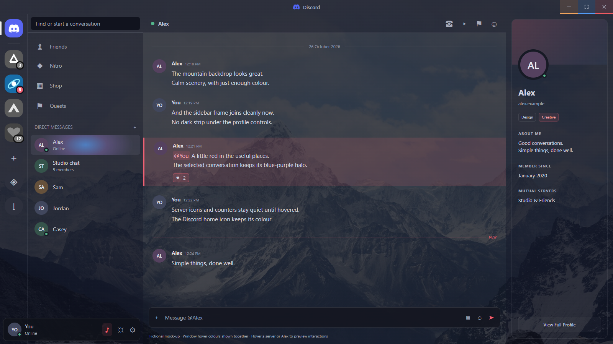

# Alpine Crimson

A mountain-wallpaper theme for Dorion, with readable dark surfaces, restrained
red accents and an optional configurable conversation halo.



This is an illustrative mock-up, not a screenshot of a real account. The three
window-button hover treatments are shown together for comparison. One server is
hovered to demonstrate colour returning; the other idle server icons and counters
remain greyscale. Open [the interactive mock](preview.html) locally to try the
hover treatments.

## What lives where

| Component | Responsibility |
| --- | --- |
| `alpine-crimson.css` | Wallpaper, palette, square sidebar frame, header coverage, window-control hover colours, greyscale artwork/counters and halo appearance |
| `Alpine-Crimson.js` | Optional local companion: configurable DM target, pointer-following coordinates and target marking after navigation |
| Custom application build | Discord name/icon, integrated Windows titlebar and removal of the startup splash |

The chat overlay is 78% opaque; side panels and headers are 86% opaque. Minimise,
maximise/restore and close use orange, blue and red hover/focus highlights.
The home icon is never greyscaled. Server artwork regains colour when hovered or
selected; notification counters regain colour when hovered.

The packaged theme also embeds a static **#623BA0 purple cursor**, using the
original maroon cursor's 32px artwork and hotspot `(26, 10)`. There is no click
animation or Windows-wide cursor change. The rules target app surfaces and
interactive controls rather than overriding text fields and resize handles.

## Install the theme on Windows

From the repository root, package the stylesheet and embedded wallpaper:

```powershell
& '.\themes\alpine-crimson\Build-AlpineCrimson.ps1' `
  -OutputPath "$env:USERPROFILE\dorion\themes\Alpine-Crimson.css"
```

Enable `Alpine-Crimson.css` in the client's theme settings, then reload or restart.
The packaged stylesheet works offline and does not fetch the wallpaper.
The integrated titlebar requires this branch's custom app build; installing CSS
alone does not rename an existing Dorion installation.

## Optional conversation halo

Edit the setting near the top of `Alpine-Crimson.js`:

```javascript
const targetName = 'Alex'
```

Replace `Alex`, a fictional example, with the exact displayed DM name. No account
or channel IDs are required. The name is escaped before it is used in a selector.
This assumes the English accessible label `NAME (direct message)` and applies to
the first matching row if names are duplicated.

Copy the file into your local plugins directory:

```powershell
Copy-Item '.\themes\alpine-crimson\Alpine-Crimson.js' `
  "$env:USERPROFILE\dorion\plugins\Alpine-Crimson.js"
```

Enable it in the client's local plugin settings with **preload disabled**, then
restart. Do not replace your existing `plugins.json`; preserve other plugins.
The selected conversation keeps its halo when the pointer leaves; an unselected
conversation shows it only while hovered. Shop's original canvas halo is hidden
by the theme. The companion does not send network requests, read message contents
or intercept clicks. Its halo styling disappears when the theme is disabled.

## Preview and checks

Serve the repository root with a local static server, then open
`themes/alpine-crimson/preview.html`. The mock uses only local assets and
fictional people/messages. Its window controls are non-functional examples.

```powershell
node --test .\themes\alpine-crimson\Alpine-Crimson.test.mjs
```

Discord's DOM classes can change upstream; selectors may need maintenance.
To uninstall, disable the theme and companion in settings, restart, and remove
only their own files.

## Attribution

Wallpaper: [Unsplash photograph](https://images.unsplash.com/photo-1454496522488-7a8e488e8606),
downloaded from
<https://images.unsplash.com/photo-1454496522488-7a8e488e8606?auto=format&fit=crop&w=1920&q=85>.
[Unsplash licence](https://unsplash.com/license).

This is an unofficial customisation of [SpikeHD/Dorion](https://github.com/SpikeHD/Dorion),
not an official Discord distribution. Upstream project attribution and licence
remain unchanged.
